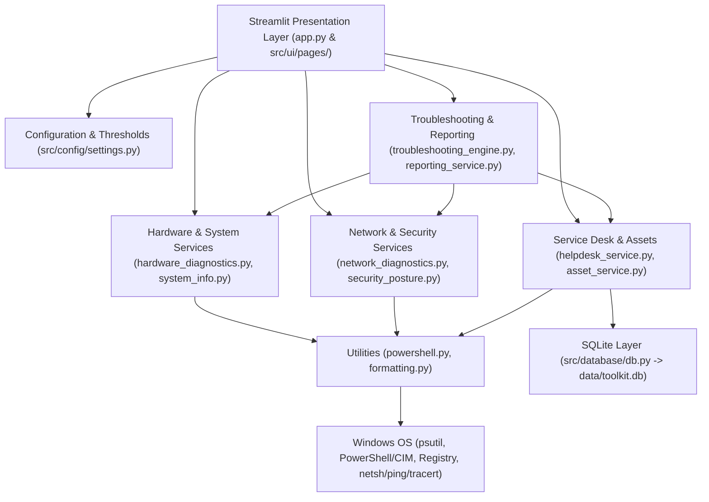

# Enterprise IT Support & Network Diagnostics Toolkit

A Windows-first, read-only enterprise endpoint diagnostics, network troubleshooting, security posture assessment, and IT service-desk portfolio application built with **Python**, **Streamlit**, **Psutil**, **Windows PowerShell (CIM/WMI)**, **SQLite**, **Pandas**, and **Plotly**.

---

## Problem Statement

IT Support and Infrastructure teams in financial services environments operate under strict least-privilege controls, change-management rules, and data-privacy requirements. Frontline analysts frequently need to triage slow workstations, intermittent network or DNS faults, security baseline drift, and asset/incident records without:

- Running unvetted scripts that alter operating system, firewall, antivirus, or network settings.
- Requiring local Administrator elevation for routine diagnostic checks.
- Exposing sensitive workstation identifiers (usernames, hostnames, IP/MAC addresses, or hardware serial numbers) in exported reports or version control.

---

## Project Objectives

1. **Non-Destructive Telemetry**: Collect real local hardware, OS, process, service, software, network, and security baseline metrics strictly in read-only mode.
2. **Honest & Bounded Execution**: Enforce strict subprocess/network timeouts and explicitly report `Unknown` or `Unavailable` when permissions or hardware sensors are restricted—never fabricating data.
3. **Structured Service Operations**: Provide persistent SQLite IT Help Desk ticketing and IT Asset/License Management without storing sensitive license keys.
4. **Actionable Triage & Audit Reporting**: Correlate multi-module telemetry into evidence-backed troubleshooting playbooks and exportable, privacy-redactable CSV and self-contained HTML reports.

---

## Core Features

| Module | Capabilities |
| :--- | :--- |
| **Overview Dashboard** | Live CPU, RAM, Disk, and Uptime KPIs, Plotly utilization gauges, passive Network/Security summary, Help Desk & Asset counts, and module readiness status |
| **Hardware Diagnostics** | CPU usage & per-core chart, processor/cache specs, RAM & physical DIMM slots, logical partitions & physical drives, battery telemetry, and BIOS/baseboard specs |
| **System Administration** | OS edition/build/uptime, searchable/sortable running processes (`AccessDenied`-safe), Windows services inventory, and read-only Uninstall registry software inventory |
| **Network Diagnostics** | Adapter status, IPv4/IPv6/MAC/subnet, gateway & DNS config, Wi-Fi signal/link details, user-triggered Ping/DNS/Traceroute/TCP connectivity checks, and rule-based guidance |
| **Information Security** | Windows Firewall profiles (Domain/Private/Public), Microsoft Defender & `SecurityCenter2` registered AV status, HotFix history, UAC policy, BitLocker status (when permitted), and baseline disclaimer |
| **IT Help Desk** | Auto-generated unique ticket IDs (`INC-`/`REQ-`), status transition validation, activity audit history, search/filter/sort, summary chart, and CSV export |
| **IT Asset Management** | Asset lifecycle registry, confirmed local diagnostic hardware/software import (serial opt-in), software license seat tracking (no keys stored), and CSV export |
| **Troubleshooting Assistant** | Rule-based evaluation across 15 scenarios separating confirmed evidence from suspected root causes, verification/escalation steps, and confirmed ticket creation |
| **Technical Reporting** | 8 structured report types with CSV and self-contained HTML exports, HTML escaping, CSV formula neutralization, and privacy-safe PII/identifier redaction |

---

## Technology Stack

- **UI & Visualization**: Python 3.13, Streamlit, Plotly, Pandas
- **System & Network Telemetry**: `psutil`, Windows PowerShell (`Get-CimInstance` / Registry / `NetSecurity` / `Defender` read-only queries), `socket`, `subprocess`, `netsh`, `ping`, `tracert`
- **Persistence**: SQLite (`sqlite3`) with parameterized queries and versioned schema migrations
- **Testing**: `pytest` (unit tests, mocked error/timeout/permission tests, temporary SQLite tests, and live Windows smoke tests)

---

## System Architecture



For full architectural details, see [ARCHITECTURE.md](ARCHITECTURE.md).

---

## Installation Instructions

### Prerequisites
- Windows 10 / Windows 11 (recommended for full CIM/PowerShell/Defender/WLAN telemetry)
- Python 3.13+ (compatible with `streamlit>=1.50.0`)

### Setup

```powershell
# 1. Clone and enter the repository directory
git clone https://github.com/dilumgit/enterprise-it-support-toolkit.git
cd enterprise-it-support-toolkit

# 2. (Recommended) Create and activate a virtual environment
python -m venv .venv
.\.venv\Scripts\Activate.ps1

# 3. Install dependencies
python -m pip install -r requirements.txt
```

---

## Application Startup Instructions

The application is bound strictly to localhost (`127.0.0.1`) via `.streamlit/config.toml`.

```powershell
python -m streamlit run app.py
```

Open your browser to the local URL printed by Streamlit (typically `http://127.0.0.1:8501`).

---

## Testing Instructions

Run the complete automated test suite (**65 passing tests** across 12 test files using mocked error/timeout/permission scenarios, temporary SQLite databases, and read-only local smoke checks):

```powershell
python -m pytest -v
```

Additional documentation:
- [User Guide](docs/USER_GUIDE.md)
- [Manual Test Cases](docs/TEST_CASES.md)
- [Troubleshooting Standard Operating Procedures](docs/TROUBLESHOOTING_SOP.md)
- [System Architecture](ARCHITECTURE.md)
- [Implementation Plan](IMPLEMENTATION_PLAN.md)

---

## Security and Privacy Design

- **Read-Only Endpoint Inspection**: Never modifies host network settings, Windows Firewall, Microsoft Defender, services, or Windows Registry. Software inventory reads Uninstall registry hives instead of `Win32_Product` to avoid triggering MSI repairs.
- **Command Injection Prevention**: Network targets pass strict IPv4/IPv6/RFC hostname allowlist validation (rejecting leading `-` and shell metacharacters). CIM class/property/namespace identifiers are validated against alphanumeric patterns.
- **Database & Export Safety**: All SQLite statements use parameterized queries. HTML exports escape all dynamic values via `html.escape` with zero external scripts or tracking. CSV exports neutralize spreadsheet formula prefixes (`=`, `+`, `-`, `@`, `\t`, `\r`).
- **Privacy-Safe Reporting**: Technical Reporting includes a **Privacy-Safe Redaction** toggle (enabled by default) that scrubs hostnames, usernames, `DOMAIN\user`, email addresses, Windows user profile paths, IPv4/IPv6 addresses, MAC addresses, serial numbers, and employee names.
- **Localhost & Git Hygiene**: Streamlit binds to `127.0.0.1`, no credentials or license keys are stored, and `.gitignore` excludes `data/*.db*`, `reports/*`, `.env`, and virtual environments.

---

## Known Limitations

- **Standard-User Permissions**: Running without Administrator elevation prevents reading protected OS processes (`AccessDenied`) and may restrict `Get-BitLockerVolume` access depending on OS edition and policy; affected checks report `Unavailable` or skip cleanly.
- **User-Triggered Network Probes**: External probes (`ping`, `tracert`, DNS lookup, TCP connectivity) never run automatically in the background and require explicit user action.
- **Single-User Local Persistence**: SQLite storage (`data/toolkit.db`) is intended for local workstation/portfolio demonstration without multi-user authentication or remote syncing.
- **Baseline Security Scope**: Information Security checks evaluate local baseline posture indicators only and do not replace enterprise EDR, vulnerability scanners, or patch-management compliance consoles.

---

## Application Screenshots

> Actual sanitized application screenshots are not yet included in this repository. Launch `python -m streamlit run app.py` locally to inspect the dark dashboard and capture screenshots for `docs/screenshots/` before publishing visual previews.

Planned screenshot captures:
- **Overview Dashboard** — Live CPU, RAM, Disk, Uptime, Network, Security, and Service Desk KPIs
- **Hardware & System Telemetry** — Per-core CPU chart, DIMM inventory, storage volumes, processes, services, and Uninstall registry software
- **Network Diagnostics & Connectivity Check** — Adapter table, Wi-Fi telemetry, and user-triggered Ping/DNS/Traceroute/TCP probes
- **Information Security Posture** — Windows Firewall profiles, Defender/AV status, HotFix history, UAC policy, and BitLocker fallback
- **IT Help Desk & Asset Management** — SQLite incident queue, activity history, asset lifecycle, and license seat tracking
- **Troubleshooting Assistant & Technical Reporting** — 15-scenario rule engine findings and CSV/HTML privacy-redacted report exports
